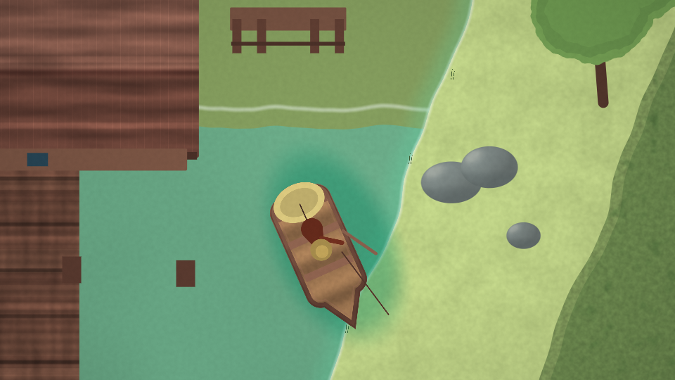
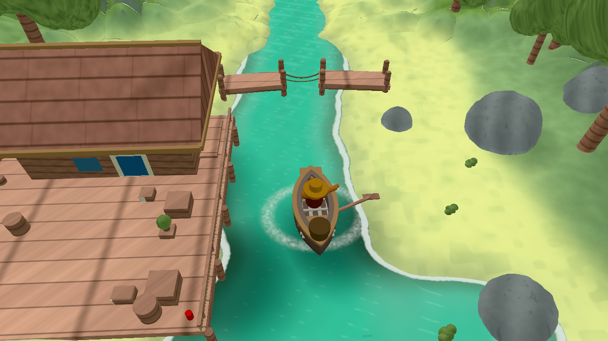
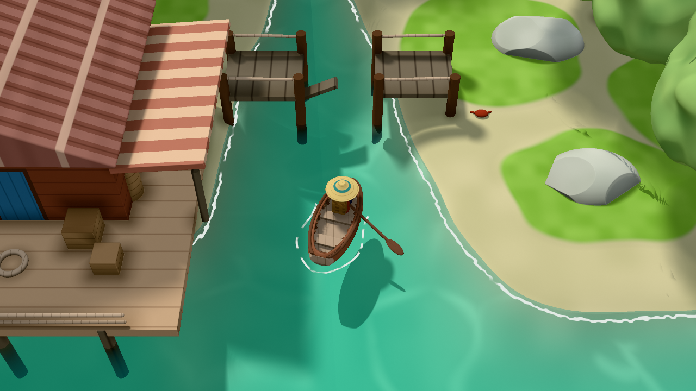
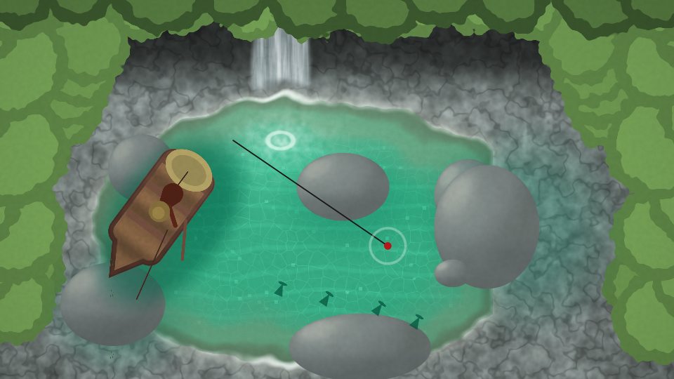
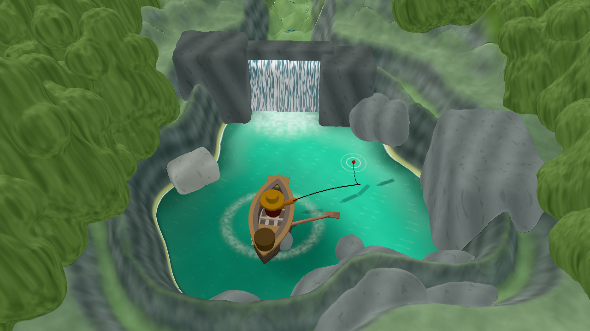
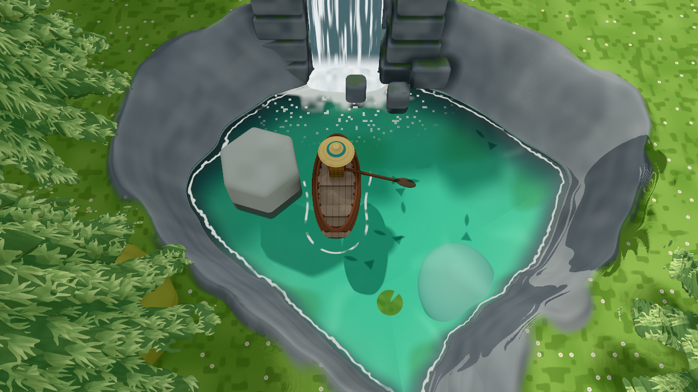
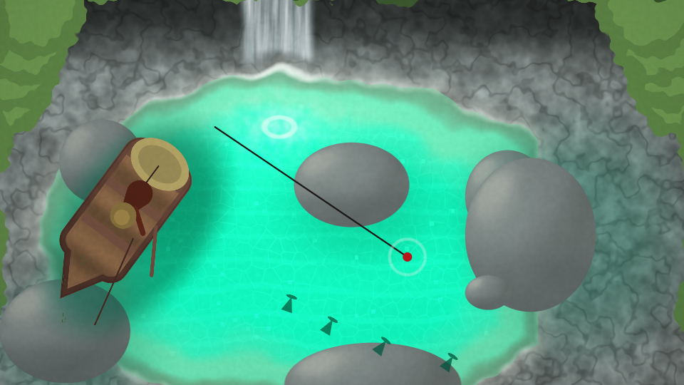
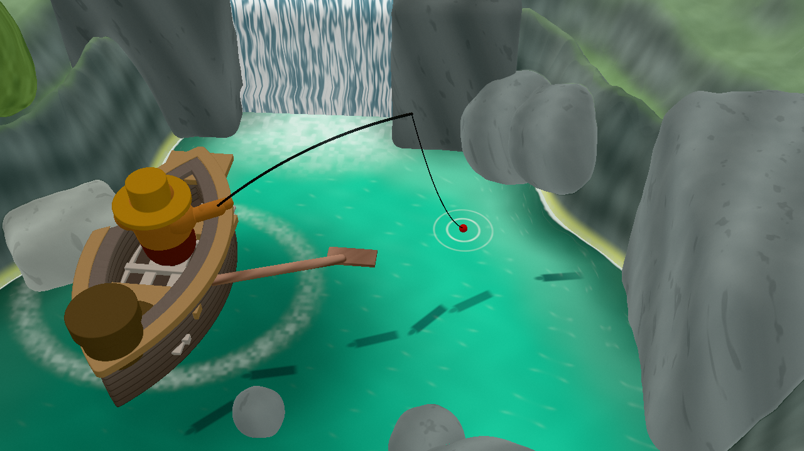
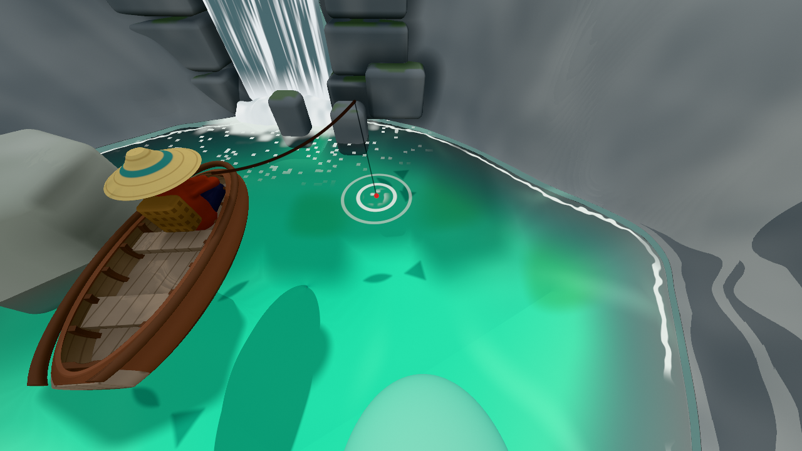

# creek-shader-remake

[中文说明](README.zh.md)

Two coding agents were given the same task: recreate a 14-second clip of a 3D fishing game as **one
Shadertoy GLSL fragment shader**. This repository holds the task brief, the scorer, the shaders each run
produced, their renders and notes, and the scripts to rebuild the reference and re-score every run.

- **Reference:** a clip from [@sorenxet's post](https://x.com/sorenxet/status/2111892085444092101) of a cozy
  fishing game built with Opus 5.5 + Blender + Unity 6. The footage is **not** in this repository;
  `tools/fetch_reference.sh` downloads it.
- **Skill:** [`shader-art-coding`](https://github.com/gokayfem/shader-skills) by gokayfem (MIT), commit
  `b19dcf9`. Not vendored; `tools/install_skill.sh` installs it.
- **Agents:** [DeepSeek Harness](https://github.com/deepseek-ai/deepseek-harness) (dsh) with
  `deepseek-flash`, reasoning effort `max`; Claude Code with Claude Opus 5.5.

## The three stages

| Stage | Who | Acceptance | Result |
|---|---|---|---|
| 1 | dsh alone | a rubric and scorer it wrote itself; 10-round goal | **not met** after 10 rounds; stills only |
| 2 | Claude Opus 5.5 with the experimenter | rewrote only the acceptance section of `TASK.md` and extended `score.py` (143 → 395 lines) | three layers: hard checks, reported indicators, visual review as the verdict |
| 3 | dsh and Claude Code side by side, 3 rounds each | the same final `TASK.md` | both pass the hard checks and their final visual review; details below |

The experimenter talked to the agents throughout (choosing options, asking for gap analyses, pointing out defects).
The full timeline is in [`docs/process.md`](docs/process.md).

## Results

| | Stage 1: dsh alone | Stage 3a: dsh | Stage 3b: Claude Code |
|---|---|---|---|
| Hard checks H1–H3 | — | pass | pass |
| Reference indicators missed | — | 2 | 0 |
| Layout agreement, mean / min over the clip | — | 0.54 / 0.42 | 0.64 / 0.55 |
| Library functions called | — | 30 | 50 |
| Final independent visual review | — | PASS, water "partial" | PASS with reservations; last fixes not re-reviewed |
| Deliverables | 3 stills (960×540) | 3 stills + video (1280×720) | 3 stills + video (1280×720) |

Layout agreement anchors measured on the reference itself: different scenes ≈ 0.25; the same shot 1 s apart ≈ 0.65.

| t | Stage 1: dsh alone | Stage 3a: dsh | Stage 3b: Claude Code |
|---|---|---|---|
| 2 s |  |  |  |
| 6 s |  |  |  |
| 12 s |  |  |  |

Videos: [`runs/03a-dsh/verify/render.mp4`](runs/03a-dsh/verify/render.mp4),
[`runs/03b-claude-code/verify/render.mp4`](runs/03b-claude-code/verify/render.mp4).
Every `final.glsl` pastes into [Shadertoy](https://www.shadertoy.com/new) as is.

## Layout

```
task/
  TASK.md          final brief, Chinese original (what both stage-3 agents received)
  TASK.en.md       English translation
  TASK-v1.md       the brief before stage 2 rewrote its acceptance section
  score-v1.py      the scorer that went with TASK-v1.md
tools/
  score.py             final scorer (H1–H3, Q1–Q5, T1/T2, L; writes verify/review/)
  fetch_reference.sh   rebuild assets/ from the public post
  install_skill.sh     install shader-art-coding @ b19dcf9 into .claude/skills and .dsh/skills
  make_workspace.sh    create a stage-3 project directory, optionally seeded with a run
runs/
  01-dsh-solo/       creek.glsl, creek.bundle.glsl, render.py, score.py, RUBRIC.md, README.md, out/ stills
  03a-dsh/           work.glsl, final.glsl, NOTES.md, tools/render.py, verify/ stills + render.mp4
  03b-claude-code/   work.glsl, final.glsl, NOTES.md, tools/ (render.py, cmp.sh, full.sh, fit_cam.py),
                     verify/ stills + render.mp4 + score.txt
docs/process.md      timeline of the three stages
```

Stage-1 stills: `own-A.png` is t = 2 s, `own-B-wide.png` t = 6 s, `own-B-close.png` t = 12 s.
Files under `runs/` are as the agents wrote them, with these edits: absolute paths shortened, round-by-round
logs removed, and a note at the top of each edited document saying what changed.

## Reproduce

Requirements: Python 3 with numpy, ffmpeg/ffprobe (≥ 5), yt-dlp, git. Optional: glslangValidator
(`glsl_tools.py check` compiles with it), Playwright with Chromium (stage-3 renderers), Google Chrome
(stage-1 renderer).

```bash
tools/fetch_reference.sh     # assets/: reference.mp4, ref-t2.0/6.0/12.0.png, contact-sheet.png
tools/install_skill.sh       # .claude/skills/shader-art-coding (+ .dsh/skills link)
```

`fetch_reference.sh` checks the result against the clip used in the runs (first video pts 0.083 s,
338 frames, hash of the per-frame hashes) and exits non-zero on a mismatch.

**Re-score a stage-3 run:**

```bash
tools/make_workspace.sh /tmp/ws-claude 03b-claude-code
cd /tmp/ws-claude && python3 tools/score.py --own-dir verify
```

This prints the same report as the run's `NOTES.md` and writes `verify/review/sheet.png` and
`side_by_side.mp4` (reference left, recreation right) for the visual review.

**Re-render a stage-3 run** inside its workspace (Playwright + Chromium):

- dsh: the commands in section "4. Reproduce" of `runs/03a-dsh/NOTES.md`.
- Claude Code: `mkdir -p /tmp/cr && W=1280 tools/full.sh` (the script writes its score summary to `/tmp/cr/`).

**Stage 1** runs from the repository root: `python3 runs/01-dsh-solo/score.py` scores the committed stills
against frames it extracts from `assets/reference.mp4`; `--render` and `--motion` need its Chrome daemon
(`python3 runs/01-dsh-solo/render.py daemon`).

**Run the experiment again:** create a fresh workspace with `tools/make_workspace.sh <dir>` (no run name),
open it in Claude Code or DeepSeek Harness, and send `@TASK.md 按这个目标执行`.

### Verified

With ffmpeg 9.0.2, yt-dlp 2026.08.19, Python 3.14 and numpy 2.5: the rebuilt `reference.mp4` has the same
video and audio packet timestamps and the same decoded frames as the original; the three reference frames
and the contact sheet are pixel-identical. `tools/score.py` gives identical output with the original and
the rebuilt assets for both stage-3 runs, and that output equals the report recorded in each run's
`NOTES.md`. The stage-1 `score.py` reproduces its round-10 numbers.

## Credits and licence

- Reference game and footage: [@sorenxet](https://x.com/sorenxet). Not included; all rights remain with
  @sorenxet.
- [shader-skills](https://github.com/gokayfem/shader-skills) by gokayfem, MIT. Its own credits list the
  published techniques the library implements.
- [DeepSeek Harness](https://github.com/deepseek-ai/deepseek-harness) by DeepSeek AI;
  [Claude Code](https://claude.com/claude-code) by Anthropic.

Everything in this repository is MIT licensed, © 2026 Duoduo · openduo.ai. See [LICENSE](LICENSE).
